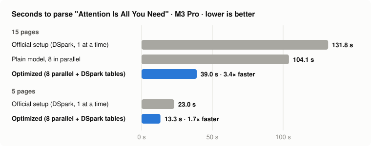
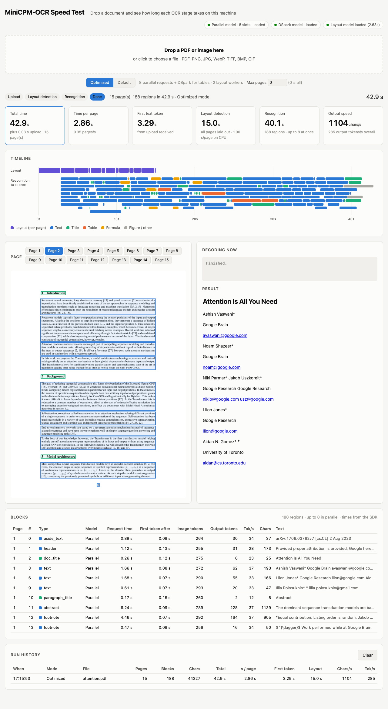

# MiniCPM-OCR on Apple Silicon, 3.4× faster

A local setup for [MiniCPM-OCR 1.0](https://github.com/OpenBMB/MiniCPM-OCR) on Apple Silicon Macs that parses documents **up to 3.4× faster** than the official Ollama setup. The output is **byte-identical**. It includes a drag-and-drop web page that times every stage of the OCR pipeline, so you can see the difference on your own documents.



## The benefit

Measured on a MacBook Pro M3 Pro (36 GB) with Ollama 0.40.16, parsing the arXiv paper "Attention Is All You Need". The models were already loaded.

| | Official setup | This setup | Speed-up |
|---|---|---|---|
| 5 pages | 23.0 s (4.6 s/page) | 13.3 s (2.7 s/page) | **1.7×** |
| 15 pages | 131.8 s (8.8 s/page) | 39.0 s (2.6 s/page) | **3.4×** |
| 15 pages, through the web page | 139.2 s | 42.9 s | **3.2×** |
| Output Markdown | | | **identical, byte for byte** |

The longer and more varied the document (tables, references, figures), the bigger the gain, because that's where the official setup loses the most time.

## What changed and why

MiniCPM-OCR works in two stages. A layout model finds the regions on each page (paragraphs, titles, tables, formulas), then MiniCPM-OCR reads each region. The official Apple Silicon guide reads **one region at a time** with DSpark, a speculative decoding add-on that drafts several tokens per step.

Benchmarking every option on this machine showed:

1. **DSpark doesn't get faster with parallel requests.** It already keeps the GPU busy. 2 parallel requests took 31 s and 4 took 52 s, against 23 s for one at a time.
2. **The plain model does get faster with parallel requests.** Ollama batches them on the GPU, and 8 at once is the sweet spot: 12.4 s for 5 pages. 16 at once is no faster.
3. **Tables are the exception.** Table HTML is so predictable that DSpark reads it about 13× faster. In the 8-parallel run, one 681-token table took 48.6 s instead of 3.7 s and became the last thing to finish.
4. **So each region goes to the model that suits it.** Tables go to the DSpark model, and everything else goes to the plain model with 8 requests at once. This is about 30 lines in [`speedtest/engines.py`](speedtest/engines.py), plugged into the SDK without patching it.
5. **The two models run in two Ollama instances.** A single Ollama keeps only one of them in memory and swaps on every switch, which made routing slower than doing nothing (135 s).
6. **Two smaller settings:**
   - 2 layout workers run on the CPU.
   - The SDK's worker count matches Ollama's slot count. 8 workers on 16 slots took 25 s instead of 12 s.

Full numbers for every configuration tried are in [`speedtest/README.md`](speedtest/README.md).

## The speed-test page



- **Input:** drag and drop a PDF or image anywhere on the page.
- **Mode:** switch between **Optimized** and **Default** (the official setup) to compare on the same document.
- **Results:**
  - Total time, time per page, time to the first text, layout and recognition time, output speed
  - A timeline of layout per page and of every region, with regions read in parallel shown as separate rows
  - The page with detected regions highlighted live, the text streaming as it's decoded, and the final Markdown
  - Per-region request time, image and output tokens, and which model handled the region
  - A history of runs, for comparing documents and modes

## Quick start

Needs an Apple Silicon Mac, [Ollama](https://ollama.com/download) 0.40.12 or newer, `git`, `curl` and [`uv`](https://docs.astral.sh/uv/).

```bash
./setup.sh             # one time, ~7 GB: upstream checkout, SDK environment, models
./speedtest/start.sh   # then open http://127.0.0.1:8000
```

`start.sh` starts two dedicated Ollama instances on ports 18499 (plain model, 8 slots) and 18500 (DSpark model, 1 slot), registers the models, and serves the page on port 8000. An Ollama already running on the default port 11434 is left alone. Stop everything with Ctrl+C in that terminal, then stop the two Ollama instances on 18499 and 18500.

## Reproduce the benchmark

```bash
curl -L -o samples/attention.pdf https://arxiv.org/pdf/1706.03762v7
source MiniCPM-OCR/.minicpm-ocr/bin/activate
cd speedtest

# Optimized (needs both Ollama instances from start.sh)
python bench.py ../samples/attention.pdf --pages 15 --workers 8 --layout-workers 2 \
  --route minicpm-ocr-nodraft,minicpm-ocr
# Official setup
OCR_URL=http://127.0.0.1:18500 python bench.py ../samples/attention.pdf --pages 15 --workers 1
```

Each command runs the document twice and reports the faster run. The first run after Ollama loads a model also includes Metal warm-up.

## Layout

```
setup.sh              one-time install (upstream checkout, SDK venv, model files)
speedtest/
  start.sh            starts the two Ollama instances and the page
  server.py           page server: streams timed events, Optimized / Default modes
  engines.py          routes tables to DSpark, everything else to the parallel model
  ocrcfg.py           shared SDK configuration
  bench.py            command-line benchmark
  static/index.html   the page
samples/              small test documents
docs/                 chart and screenshot used here
```

`MiniCPM-OCR/` (the upstream checkout with its environment and about 5 GB of models) is created by `setup.sh` and is not tracked.

## Credits

MiniCPM-OCR, its SDK and the models are by [OpenBMB](https://github.com/OpenBMB/MiniCPM-OCR) under the Apache 2.0 license. Layout detection uses PaddlePaddle's PP-DocLayoutV3.
